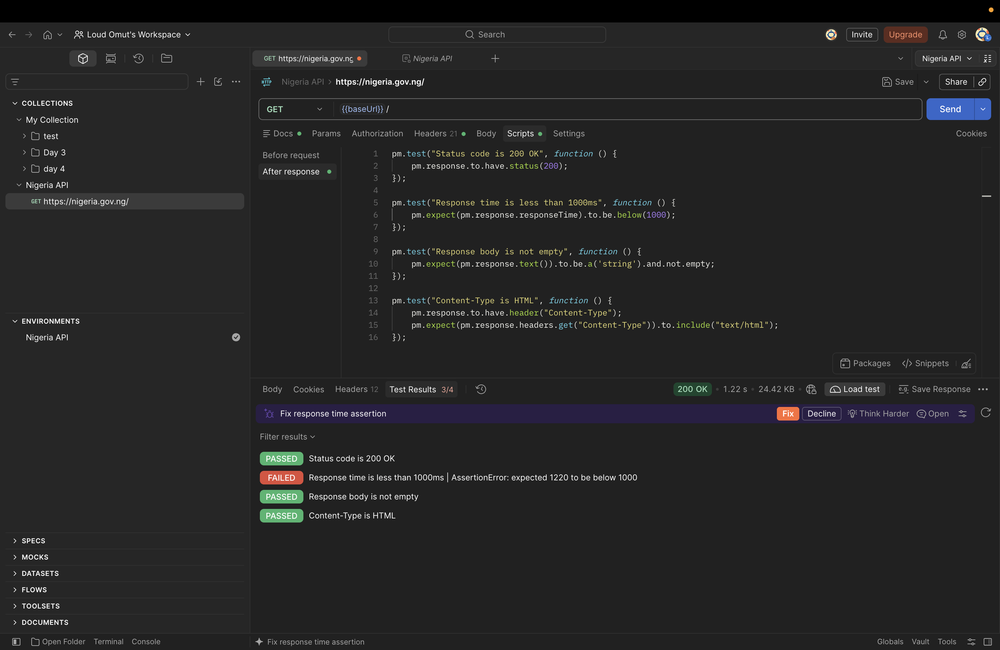
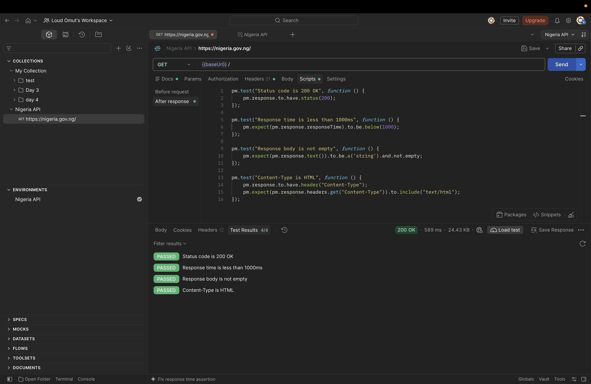

Цель проекта — проведение комплексного ручного и API-тестирования официального портала федерального правительства Нигерии (`https://nigeria.gov.ng/`) 
для оценки его базовой работоспособности, отзывчивости, защищенности конфигурации и корректности обработки ошибок.

## Задачи тестирования:
1. **Проверка кроссбраузерности и адаптивности:** 
Сайт стабильно открывается во всех популярных браузерах (Chrome, Safari, Firefox и т.д.) как в десктопной (ПК), так и в мобильной версиях.

2. *Анализ времени ответа:* 
Скорость отклика сервера (ожидаемый порог — не более 500 мс).

3. *Проверка элементов интерфейса:* 
Все интерактивные кнопки, ссылки и вкладки на главной домашней странице корректно работают и ведут на целевые страницы.

4. *Проверка обработки несуществующих страниц (Soft 404 / 404 Not Found):* 
Исследовать реакцию сервера на запросы несуществующих путей, включая потенциально чувствительные разделы (например, `/admin`, `/settings` и др.).

5. *Тестирование HTTP-методов:*
Проверить реакцию сервера на запрещённые или нецелевые для публичной страницы методы (`DELETE`, `PUT`).

6. *Анализ WordPress REST API:* 
Проверить конфигурацию API на предмет потенциальной утечки конфиденциальных данных (например, списков пользователей, системных эндпоинтов).

7. *Оценка заголовков безопасности (Security Headers):*
Проверить наличие базовых защитных заголовков (HSTS, X-Frame-Options и др.).

*Проверка кроссбраузерности и адаптивности*

Я проверил как открывается домашняя страница https://nigeria.gov.ng/ 

Тестирование проводилось на реальных устройствах и через облачные эмуляторы (15 конфигураций).

| Платформа | Браузер | Результат | Скриншот |
| :--- | :--- | :--- | :--- |
| Windows 11 | Chrome, Edge, Opera, Mozilla | ✅ Корректно | — |
| Windows 11 | Yandex Browser | 🟡 Баг вёрстки |  |
| macOS | Chrome, Safari | ✅ Корректно | — |
| Windows XP | Chrome, Yandex, IE | ℹ️ Не открывается (устаревший TLS) |  |
| Mobile (iOS) | Safari, Chrome, Telegram | ✅ Адаптивно |  |

# Анализ времени ответа

# Наблюдение: Зависимость времени ответа от частоты запросов (Cold Start Effect)
- Зафиксирована плавающая производительность главного эндпоинта (`GET /`). 
- *Метрики:*
  - *Первый запрос после простоя (более 1 минуты):* `> 1000 ms` (эффект «холодного старта», пересборка кэша на сервере).  
    
  - *Повторные запросы подряд:* `~500–600 ms` (сервер отдаёт данные из кэша).  
    
- *Вывод:* Архитектура сайта на базе WordPress имеет задержку при старте сессии, но при частых запросах укладывается в допустимые нормы. 

# Проверка элементов интерфейса
- Все интерактивные кнопки, ссылки и вкладки на главной домашней странице корректно работают и ведут на целевые страницы. ✅

---

# Проверка обработки несуществующих страниц и чувствительных разделов (Soft 404 / Security Audit)
- *Исследование путей:* Проведена проверка реакции сервера на запросы потенциально чувствительных разделов (`/admin`, `/settings` и др.).

- *Результаты проверки:*
  - *Доступ к панели управления (`/admin`):* Обнаружен незащищенный доступ к стандартной форме авторизации WordPress. 
    
  - *Проверка восстановления пароля:* При попытке восстановления доступа через форму система выдает явную ошибку о наличии или отсутствии конкретного email-адреса в базе (риск *User Enumeration*).
    
  - *Обработка несуществующих страниц (`/settings` и произвольных путей):* Сервер корректно отрабатывает запросы несуществующих путей, возвращая стандартную страницу ошибки.
    
- *Вывод:* Рекомендуется скрыть стандартные пути административной панели WordPress и настроить универсальные ответы на формы восстановления для повышения безопасности государственного портала.

# Тестирование HTTP-методов
- *Цель:* Проверить реакцию сервера на нецелевые и потенциально опасные методы (`DELETE`, `PUT`) для публичной главной страницы.
- *Ход тестирования:* Через Postman на корневой эндпоинт (`GET /`) был отправлен запрос с методом `DELETE`.
- *Результат:* Сервер вернул статус-код `200 OK` и отдал тело главной страницы вместо отказа (`405 Method Not Allowed`). Фактического удаления данных не произошло (требуются права администратора).
   
- *Вывод:* Корневой маршрут обрабатывает метод без строгой фильтрации, отдавая fallback-ответ, что является типичным поведением для кэшируемых CMS.

*Анализ WordPress REST API (Утечка данных пользователей)*
- **Цель:** Проверить конфигурацию REST API на предмет раскрытия конфиденциальных данных и списков учетных записей.
- **Эндпоинт:** `GET /wp-json/wp/v2/users`
- **Результат:** Сервер вернул статус-код `200 OK` и передал JSON-массив с детальной информацией об учетных записях пользователей системы (включая открытые имена, ID и ссылки на профили авторов).
   
- **Вывод:** Обнаружена уязвимость типа *User Enumeration* через встроенный REST API. Рекомендуется ограничить доступ к эндпоинту `/wp-users` для неавторизованных пользователей или отключить публичный вывод списка авторов на уровне конфигурации CMS.

*Оценка заголовков безопасности (Security Headers)*
- **Цель:** Проверить наличие базовых защитных заголовков в ответах сервера (`Response Headers`).
- **Инструмент:** Chrome DevTools (Network tab).
- **Результат:** 
  - Сервер использует инфраструктуру Cloudflare (`cf-cache-status`), однако **отсутствуют** ключевые заголовки безопасности: `Strict-Transport-Security` (HSTS), `X-Frame-Options`, `X-Content-Type-Options` и `Content-Security-Policy` (CSP).
  -  
- **Вывод:** Конфигурация веб-сервера имеет пробелы в защите на уровне заголовков. Отсутствие `X-Frame-Options` делает портал потенциально уязвимым к clickjacking-атакам, а отсутствие HSTS снижает уровень форсированного шифрования трафика.