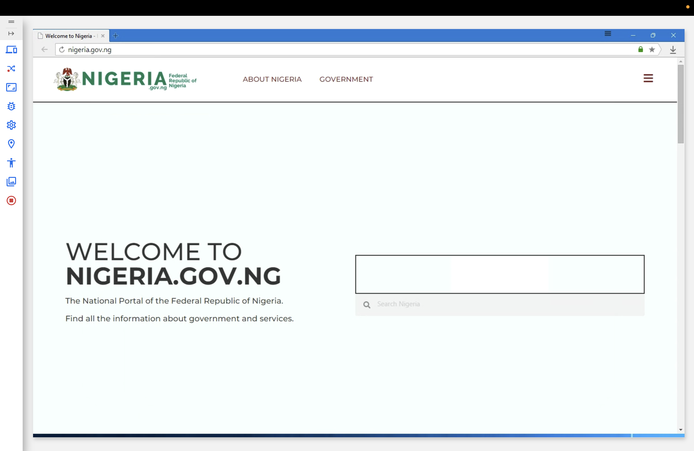
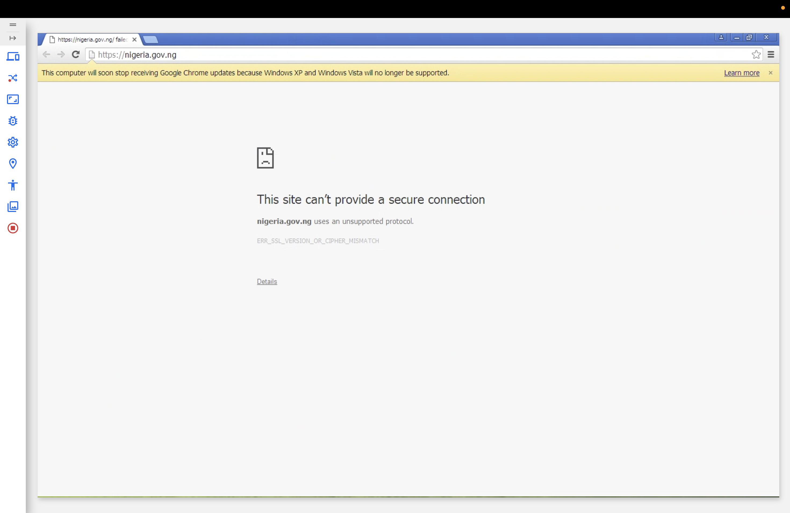
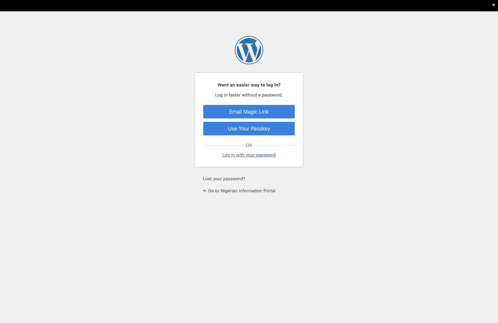
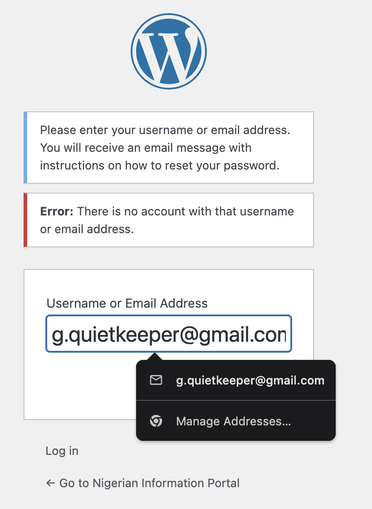
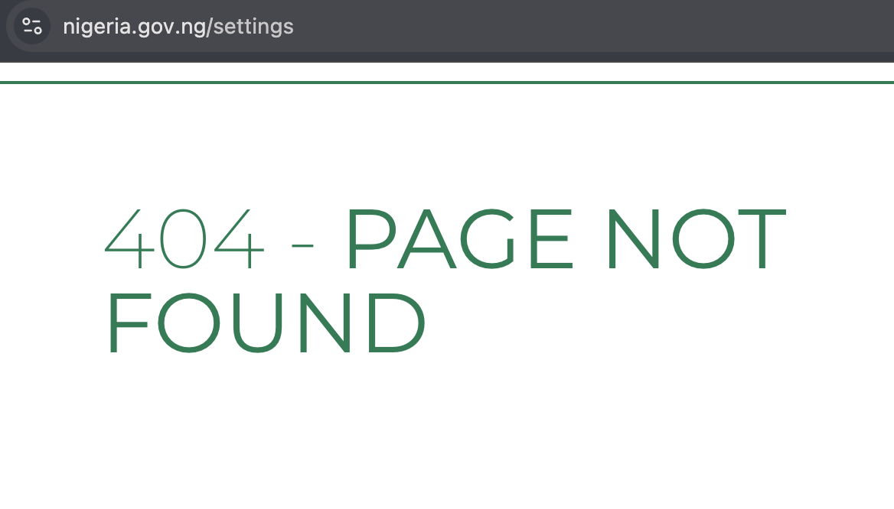
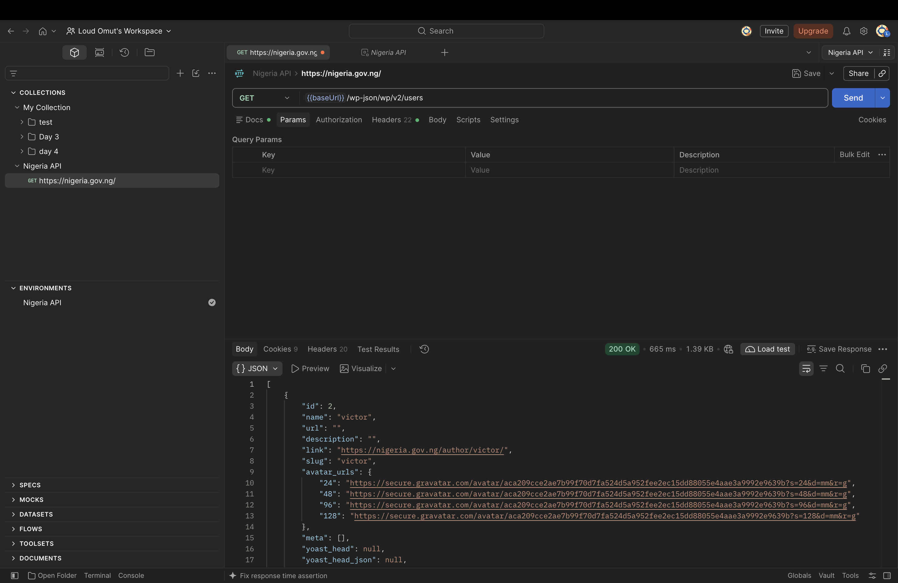

# QA Audit Report: Nigeria Government Portal (nigeria.gov.ng)

Комплексный ручной и API-тестирование официального портала федерального правительства Нигерии (`https://nigeria.gov.ng/`) с целью оценки его базовой работоспособности, производительности, защищенности конфигурации и корректности обработки ошибок.

---

## Задачи тестирования
1. **Проверка кроссбраузерности и адаптивности** — оценка корректности отображения на различных устройствах и браузерах.
2. **Анализ времени ответа** — проверка скорости отклика сервера и эффекта холодного старта.
3. **Проверка элементов интерфейса** — валидация интерактивных элементов на главной странице.
4. **Проверка обработки ошибок (Soft 404 / 404 Not Found)** — анализ поведения системы при запросе несуществующих путей.
5. **Тестирование HTTP-методов** — проверка реакции сервера на потенциально небезопасные методы (`DELETE`, `PUT`).
6. **Анализ WordPress REST API** — проверка конфигурации на предмет утечки данных и перечисления пользователей (*User Enumeration*).
7. **Оценка заголовков безопасности** — проверка наличия ключевых защитных заголовков ответа (`Security Headers`).

---

## 1. Проверка кроссбраузерности и адаптивности

Тестирование проводилось на реальных устройствах и через эмуляторы (всего 15 конфигураций) для проверки стабильности вёрстки и поддержки современных стандартов.

| Платформа | Браузер | Результат | Скриншот |
| :--- | :--- | :--- | :--- |
| Windows 11 | Chrome, Edge, Opera, Mozilla | ✅ Корректно | — |
| Windows 11 | Yandex Browser | 🟡 Баг вёрстки |  |
| macOS | Chrome, Safari | ✅ Корректно | — |
| Windows XP | Chrome, Yandex, IE | ℹ️ Не открывается (устаревший TLS) |  |
| Mobile (iOS) | Safari, Chrome, Telegram | ✅ Адаптивно |  |

---

## 2. Анализ времени ответа (Performance & Cold Start)

- **Наблюдение:** Зафиксирована плавающая производительность главного эндпоинта (`GET /`).
- **Метрики:**
  - **Первый запрос после простоя (более 1 минуты):** `> 1000 ms` (эффект «холодного старта», инициализация и сборка кэша на стороне сервера).  
    
  - **Повторные запросы подряд:** `~500–600 ms` (сервер отдаёт данные из кэша Cloudflare / WordPress).  
    
- **Вывод:** Архитектура сайта на базе WordPress демонстрирует задержку при первом обращении, однако при регулярном трафике укладывается в приемлемые нормативы отклика.

---

## 3. Проверка элементов интерфейса
- Все интерактивные кнопки, ссылки и навигационные вкладки на главной странице корректно функционируют и перенаправляют на целевые разделы. **[✅ Пройдено]**

---

## 4. Проверка обработки несуществующих страниц (Soft 404 / Security Audit)
- **Исследование путей:** Проведена проверка реакции сервера на запросы потенциально чувствительных разделов (`/admin`, `/settings` и др.).
- **Результаты проверки:**
  - **Доступ к панели управления (`/admin`):** Обнаружена незащищенная стандартная форма авторизации CMS WordPress.  
    
  - **Проверка восстановления пароля:** При отправке формы восстановления система выдает информационное сообщение о наличии или отсутствии конкретного email-адреса в базе (подверженность риску *User Enumeration*).  
    
  - **Обработка несуществующих страниц (`/settings`):** Сервер корректно обрабатывает несуществующие маршруты, выдавая страницу ошибки.  
    
- **Вывод:** Рекомендуется скрыть стандартные пути входа в административную панель и унифицировать ответы формы восстановления пароля.

---

## 5. Тестирование HTTP-методов
- **Цель:** Проверить реакцию сервера на нецелевые и потенциально опасные методы (`DELETE`, `PUT`) для публичной главной страницы.
- **Ход тестирования:** Через Postman на корневой эндпоинт (`GET /`) был отправлен запрос с методом `DELETE`.
- **Результат:** Сервер вернул статус-код `200 OK` и отдал тело главной страницы вместо отказа (`405 Method Not Allowed`). Фактического удаления данных на сервере не произошло ввиду отсутствия прав авторизации.  
  
- **Вывод:** Корневой маршрут обрабатывает метод без жесткой фильтрации, возвращая fallback-ответ, что характерно для кэшируемых WordPress-систем.

---

## 6. Анализ WordPress REST API (Утечка данных пользователей)
- **Цель:** Проверить конфигурацию REST API на предмет раскрытия конфиденциальных данных и списков учетных записей.
- **Эндпоинт:** `GET /wp-json/wp/v2/users`
- **Результат:** Сервер вернул статус-код `200 OK` и передал JSON-массив с детальной информацией об учетных записях пользователей системы (включая открытые имена, ID и ссылки на профили авторов).  
  
- **Вывод:** Обнаружена уязвимость *User Enumeration* через стандартный REST API. Рекомендуется ограничить публичный доступ к эндпоинту `/wp-users` для неавторизованных пользователей.

---

## 7. Оценка заголовков безопасности (Security Headers)
- **Цель:** Проверить наличие базовых защитных заголовков в ответах сервера (`Response Headers`).
- **Инструмент:** Chrome DevTools (Network tab).
- **Результат:** 
  - Сервер использует CDN-инфраструктуру Cloudflare (`cf-cache-status`), однако в ответах **отсутствуют** ключевые заголовки безопасности: `Strict-Transport-Security` (HSTS), `X-Frame-Options`, `X-Content-Type-Options` и `Content-Security-Policy` (CSP).  
    
- **Вывод:** Конфигурация имеет уязвимые места на уровне заголовков. Отсутствие `X-Frame-Options` делает портал потенциально уязвимым к clickjacking-атакам, а отсутствие HSTS снижает уровень форсированного шифрования соединений.